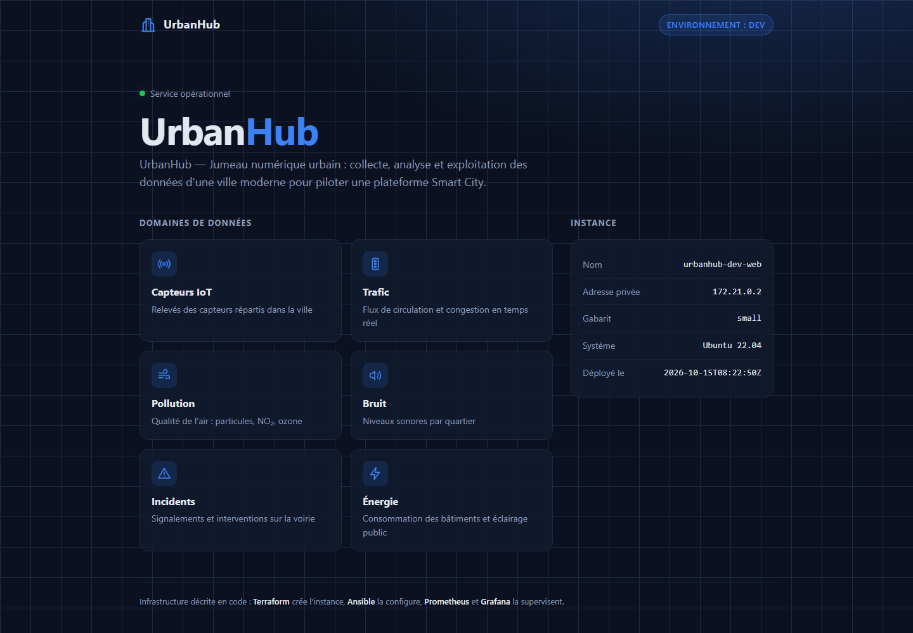
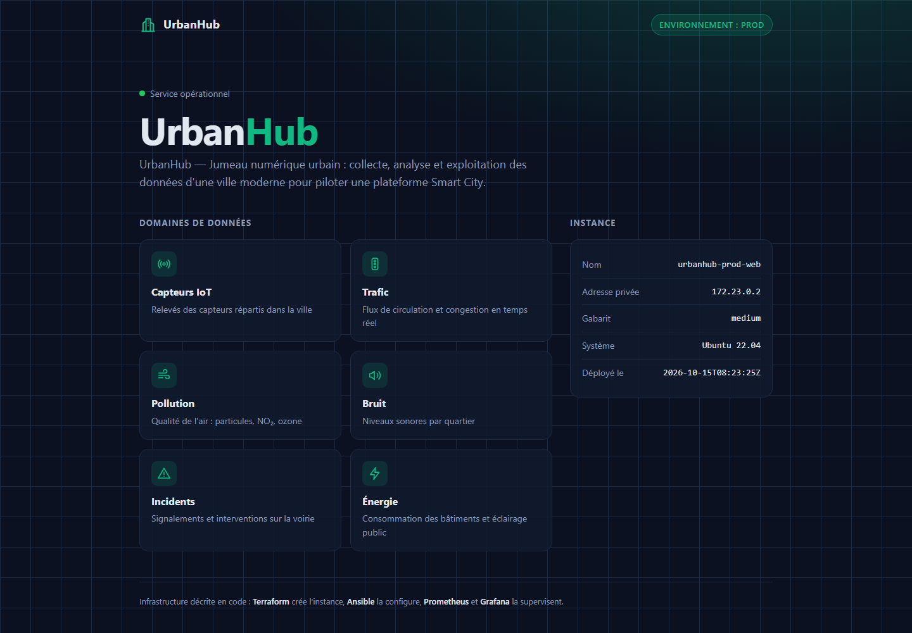

# UrbanHub — Déploiement Cloud reproductible (EC04 – Partie 1)

Microservice web **UrbanHub** (page d'accueil du jumeau numérique urbain) déployé sur une infrastructure décrite en code, sur deux environnements (`dev`, `prod`), avec tests automatiques et supervision.



## Démarrage rapide

Depuis un terminal Linux ou WSL2 Ubuntu (prérequis détaillés au §2) :

```bash
cp .env.example .env             # puis renseigner GF_ADMIN_PASSWORD
./scripts/deploy.sh dev          # tests -> Terraform -> Ansible -> supervision -> tests
curl -i http://localhost:8081/   # HTTP 200, page « Environnement : dev »
./scripts/destroy.sh dev         # destruction de l'environnement
```

## Sommaire

1. [Plateforme retenue et justification](#1-plateforme-retenue-et-justification)
2. [Prérequis](#2-prérequis)
3. [Déploiement — commande unique](#3-déploiement--commande-unique)
4. [Vérifier que le service répond](#4-vérifier-que-le-service-répond)
5. [Supervision](#5-supervision)
6. [Preuve qu'un test en échec arrête la chaîne](#6-preuve-quun-test-en-échec-arrête-la-chaîne)
7. [Destruction de l'environnement](#7-destruction-de-lenvironnement)
8. [Livrable](#8-livrable)
9. [Déclaration d'usage de l'IA](#9-déclaration-dusage-de-lia)

## Architecture

```
./scripts/deploy.sh <dev|prod>
 │
 ├─ 1. Tests pré-déploiement ── terraform fmt · terraform validate · ansible --syntax-check · secrets
 │
 ├─ 2. Terraform (workspace <env>, envs/<env>.tfvars)
 │     ├─ docker_network    urbanhub-<env>-net
 │     ├─ docker_container  urbanhub-<env>-web   image ubuntu:22.04, gabarit small | medium
 │     ├─ local_file        ansible/inventory/<env>.ini            (nom + IP injectés)
 │     └─ local_file        monitoring/prometheus/targets/<env>-*.json
 │
 ├─ 3. Ansible (inventaire généré) ── nginx · node_exporter · index.html.j2 · /health · script de boot
 │
 ├─ 4. docker compose ── Prometheus · Blackbox exporter · Grafana (communs à dev et prod)
 │
 └─ 5. Tests post-déploiement ── HTTP 200 · « UrbanHub » · data-env="<env>" · /health = OK

Supervision :
  Blackbox exporter ── GET http://host.docker.internal:8081|8082/ ──> nginx         (disponibilité, temps de réponse)
  Prometheus ────────── scrape host.docker.internal:9101|9102 ─────> node_exporter (CPU, mémoire, réseau)
  Grafana ───────────── requêtes PromQL ───────────────────────────> Prometheus    (tableau de bord)
```

```
terraform/   Instance, réseau, inventaire Ansible et cibles de supervision (générés)
ansible/     Playbook : nginx + page d'accueil (modèle Jinja2) + agent de métriques
envs/        dev.tfvars / prod.tfvars — seul fichier qui change entre environnements
scripts/     deploy.sh (commande unique), destroy.sh, package.sh, tests/
monitoring/  Prometheus (+ alertes), Blackbox exporter, Grafana (tableau de bord provisionné)
docs/        captures d'écran référencées par ce README
```

> Les captures de ce README sont versionnées dans `docs/captures/`. Dans l'archive de rendu, elles se trouvent dans `01_depot_git/docs/captures/` et, avec toutes les autres preuves, dans `02_preuves/`.

## 1. Plateforme retenue et justification

**Cloud simulé sur Docker**, piloté par Terraform via le fournisseur `kreuzwerker/docker`.

| Notion cloud | Équivalent simulé |
|---|---|
| API du fournisseur | API du démon Docker (`var.docker_host`) |
| Image (AMI) | `instance_image` = `ubuntu:22.04` |
| Type d'instance | `instance_type` (`small` = 512 Mo / 512 parts CPU, `medium` = 1 Go / 1024) |
| VPC / sous-réseau | `docker_network` dédié par environnement |
| Adresse publique | port publié sur l'hôte (`http_port`) |

Justification :
- **Reproductible et vérifiable par un tiers** sans compte cloud, carte bancaire ni identifiants : n'importe quel correcteur peut rejouer le déploiement.
- **Cycle court** : une instance est créée en quelques secondes, ce qui permet de rejouer la chaîne complète (dont la preuve d'échec) dans le temps de l'épreuve.
- **FinOps / impact écologique (C21)** : coût nul, aucune ressource oubliée qui tourne et facture ; les gabarits limitent mémoire et CPU comme un type d'instance réel.
- **Transposable** : le découpage (provider + variables + instance + sortie, inventaire généré, playbook) est identique sur AWS ; seul le fournisseur et la ressource d'instance changent (`aws_instance` + connexion SSH).

Limites assumées de la simulation :
- Ansible se connecte par le plugin `community.docker.docker` (équivalent d'un accès SSH).
- Il n'y a pas de `systemd` dans un conteneur : l'« activation au démarrage » est assurée par `update-rc.d` (module `service`, `enabled: true`) **et** par le script `/usr/local/bin/urbanhub-boot.sh` installé par Ansible, que la commande de démarrage de l'instance (définie dans Terraform) exécute à chaque redémarrage. Vérifiable avec `docker restart urbanhub-dev-web` puis `curl localhost:8081`.
- `node_exporter` lit `/proc` : le **réseau** mesuré est bien celui de l'instance, mais le **CPU et la mémoire** reflètent la machine hôte Docker (comme le ferait une VM qui partage son hyperviseur). Sur un vrai cloud, ces métriques seraient celles de la VM.
- La supervision joint les instances par `host.docker.internal`. Sous Docker Desktop, ce nom se résout aussi en une adresse IPv6 non routable depuis les conteneurs : la sonde Blackbox est donc forcée en IPv4 (`preferred_ip_protocol: ip4` dans `monitoring/blackbox/blackbox.yml`). Sans ce réglage, `probe_success` reste à 0 et `UrbanHubDown` se déclenche à tort.

## 2. Prérequis

| Outil | Version minimale | Version testée |
|---|---|---|
| Docker Engine ou Docker Desktop (avec `docker compose` v2) | 24 | Docker Desktop 29.6.2 |
| Terraform | 1.5 | 1.16.6 |
| Ansible (`ansible-core`) | 2.15 | 2.16.3 |
| curl, bash, git | — | — |
| zip (uniquement pour `scripts/package.sh`) | — | — |

Les versions des fournisseurs Terraform sont figées par `terraform/.terraform.lock.hcl` (versionné).
Ports libres sur l'hôte : 8081, 8082 (application), 9101, 9102 (métriques), 9090 (Prometheus), 3000 (Grafana).

### Sous Windows (WSL2)

Ansible ne s'exécute pas nativement sous Windows : **toutes les commandes se lancent depuis un terminal WSL2 Ubuntu**, dans le dossier du dépôt (ex. `/mnt/c/.../urbanhub-cloud`).

1. Docker Desktop → *Settings → General* : « Use the WSL 2 based engine » coché.
2. *Settings → Resources → WSL integration* : activer **Ubuntu**, puis *Apply & restart*. Vérifier dans Ubuntu : `docker version` doit afficher la section *Server* (si `/var/run/docker.sock` est absent, relancer la distribution : `wsl --terminate Ubuntu` depuis Windows).
3. Installer Terraform et zip **dans Ubuntu** (dépôt apt officiel HashiCorp) :

   ```bash
   sudo apt-get update && sudo apt-get install -y gnupg wget lsb-release zip ansible
   wget -qO- https://apt.releases.hashicorp.com/gpg | sudo gpg --dearmor -o /usr/share/keyrings/hashicorp-archive-keyring.gpg
   echo "deb [signed-by=/usr/share/keyrings/hashicorp-archive-keyring.gpg] https://apt.releases.hashicorp.com $(lsb_release -cs) main" | sudo tee /etc/apt/sources.list.d/hashicorp.list
   sudo apt-get update && sudo apt-get install -y terraform
   ```

Le fichier `.gitattributes` force les fins de ligne LF sur les scripts : un clone sous Windows reste exécutable par bash.

### Variables sensibles

Aucun secret n'est versionné. Elles sont documentées sans valeur dans `.env.example` :

```bash
cp .env.example .env
# puis renseigner GF_ADMIN_PASSWORD dans .env (mot de passe admin Grafana)
```

| Variable | Rôle | Obligatoire |
|---|---|---|
| `GF_ADMIN_PASSWORD` | mot de passe administrateur Grafana | oui |
| `TF_VAR_docker_host` | adresse de l'API Docker si différente de `unix:///var/run/docker.sock` | non |

## 3. Déploiement — commande unique

```bash
./scripts/deploy.sh dev     # environnement de développement
./scripts/deploy.sh prod    # environnement de production (même code, autre fichier de variables)
```

Enchaînement exécuté (toute étape en échec arrête la chaîne, message `ÉCHEC à l'étape …`) :

1. **Prérequis** : outils présents, démon Docker joignable.
2. **Tests pré-déploiement** (`scripts/tests/pre_deploy.sh`) :
   `terraform fmt -check`, `terraform validate`, `ansible-playbook --syntax-check`, recherche de secrets valorisés.
3. **Terraform** : workspace par environnement (états séparés), création du réseau et de l'instance ;
   génération de `ansible/inventory/<env>.ini` (nom et **adresse IP de l'instance injectés automatiquement**) et des cibles Prometheus.
4. **Ansible** (`ansible/site.yml`) : installation de nginx et de `prometheus-node-exporter`, page d'accueil depuis le modèle `index.html.j2`, démarrage et activation au boot, contrôle local de la page.
5. **Supervision** : `docker compose up -d` de Prometheus, Blackbox exporter et Grafana.
6. **Tests post-déploiement** (`scripts/tests/smoke_test.sh`) : HTTP 200, présence de « UrbanHub », **bon environnement** (`data-env="<env>"`), `/health` = `OK`.

Chaque exécution est journalisée dans `preuves/deploy_<env>_<horodatage>.log`.

Seul le fichier `envs/<env>.tfvars` diffère entre les environnements :

| Variable | dev | prod |
|---|---|---|
| `instance_type` | small | medium |
| `http_port` | 8081 | 8082 |
| `metrics_port` | 9101 | 9102 |

## 4. Vérifier que le service répond

```bash
curl -i http://localhost:8081/          # dev  : HTTP/1.1 200, badge « Environnement : dev »
curl -i http://localhost:8082/          # prod : HTTP/1.1 200, badge « Environnement : prod »
curl http://localhost:8081/health       # OK
terraform -chdir=terraform workspace select dev && terraform -chdir=terraform output
docker ps --filter label=project=urbanhub
```

Résultat obtenu (extrait de `preuves/reponse_environnements_20261015-103500.txt`) :

```
===== dev : curl -i http://localhost:8081/ =====
HTTP/1.1 200 OK
<body data-env="dev">
      <span class="badge">Environnement : dev</span>
            <dt>Adresse privée</dt><dd>172.21.0.2</dd>
            <dt>Gabarit</dt><dd>small</dd>
--- curl http://localhost:8081/health
OK

===== prod : curl -i http://localhost:8082/ =====
HTTP/1.1 200 OK
<body data-env="prod">
      <span class="badge">Environnement : prod</span>
            <dt>Adresse privée</dt><dd>172.23.0.2</dd>
            <dt>Gabarit</dt><dd>medium</dd>
--- curl http://localhost:8082/health
OK

===== Sonde Blackbox (probe_success) =====
  dev http://host.docker.internal:8081/ = 1
  prod http://host.docker.internal:8082/ = 1
Alertes actives : aucune
```

Même code, même commande ; seul `envs/<env>.tfvars` change. La couleur d'accent de la page (bleu en dev, vert en prod) et le bloc *Instance* permettent d'identifier l'environnement d'un coup d'œil :

| dev — `http://localhost:8081` | prod — `http://localhost:8082` |
|---|---|
|  |  |

## 5. Supervision

- Grafana : <http://localhost:3000> (utilisateur `admin`, mot de passe = `GF_ADMIN_PASSWORD`) → dossier *UrbanHub* → **UrbanHub — Supervision**.
  Panneaux : disponibilité, alertes actives, **processeur**, **mémoire**, **bande passante réseau** (entrant/sortant), **temps de réponse HTTP** (avec la ligne de seuil). Filtre par environnement.
- Prometheus : <http://localhost:9090/alerts> (règles dans `monitoring/prometheus/alerts.yml`).
- Collecte : `node_exporter` installé par Ansible sur l'instance (agent système) ; temps de réponse mesuré **de l'extérieur** par Blackbox exporter, comme le ressentirait un utilisateur.

### Alertes et justification des seuils

| Alerte | Condition | Justification |
|---|---|---|
| `UrbanHubDown` (critique) | `probe_success == 0` pendant **1 min** | 4 sondes consécutives en échec (une toutes les 15 s) : exclut un raté réseau isolé, tout en détectant une panne réelle en ~1 min. |
| `UrbanHubSlowResponse` | `probe_duration_seconds > 0,5 s` pendant **2 min** | La page statique répond en quelques millisecondes en fonctionnement normal : 500 ms représente une dégradation de plus de 50×, et reste sous le seuil d'environ 1 s où un utilisateur perçoit une interruption de sa navigation. La durée de 2 min évite les alertes sur un pic ponctuel (ex. démarrage). |
| `UrbanHubHighCPU` | CPU > **80 %** pendant **5 min** | Garde 20 % de marge pour absorber un pic ; 5 min distingue une saturation durable (à corriger : changer de gabarit) d'une rafale passagère (ex. `apt-get` pendant le déploiement). |

Déclencher l'alerte pour la preuve :

```bash
docker exec urbanhub-dev-web service nginx stop    # UrbanHubDown passe "pending" puis "firing" après ~1 min
./scripts/deploy.sh dev                             # le redéploiement rétablit le service (idempotence)
```

Chronologie observée (`preuves/alerte_UrbanHubDown_*.txt`) : nginx arrêté à 10:13:25, alerte **pending** à 10:14:06, **firing** à 10:15:08 ; l'environnement prod reste sans alerte. Le délai d'environ 40 s avant *pending* est attendu : jusqu'à 15 s pour la prochaine collecte (`scrape_interval`), puis jusqu'à 15 s pour la prochaine évaluation de la règle (`evaluation_interval`). La minute suivante correspond au `for: 1m` de la règle.

## 6. Preuve qu'un test en échec arrête la chaîne

```bash
# 1) Introduire une erreur dans le code d'infrastructure (référence à une variable inexistante)
printf 'output "test_echec" {\n  value = var.inexistante\n}\n' > terraform/zz_echec.tf
./scripts/deploy.sh dev     # => [TEST 3] terraform validate échoue, « ÉCHEC à l'étape tests pré-déploiement »
                            #    aucune commande terraform apply / ansible n'est exécutée

# 2) Corriger et relancer
rm terraform/zz_echec.tf
./scripts/deploy.sh dev     # => tous les tests passent, DÉPLOIEMENT dev RÉUSSI
```

## 7. Destruction de l'environnement

```bash
./scripts/destroy.sh dev                     # détruit l'instance et le réseau dev
./scripts/destroy.sh prod --with-monitoring  # détruit prod + la pile de supervision
```

Le script vérifie qu'aucun conteneur de l'environnement ne subsiste. L'image `ubuntu:22.04` est conservée en cache local (`keep_locally`) ; la supprimer avec `docker rmi ubuntu:22.04` si besoin.

## 8. Livrable

`./scripts/package.sh` produit `dist/EC04-P1_NomPrenom_UrbanHub_Cloud.zip` (clone du dépôt avec historique, preuves avec chemins personnels masqués, README) et affiche les identités présentes dans l'historique Git pour contrôle d'anonymat.

À lancer **depuis WSL / Linux** (il utilise `zip`, `sed -i` et `whoami`). Le nom de l'archive se passe en argument pour suivre la consigne de nommage communiquée le jour de l'épreuve : `./scripts/package.sh <NomArchive>`.

Arborescence de l'archive :

```
EC04-P1_NomPrenom_UrbanHub_Cloud.zip
└── EC04-P1_NomPrenom_UrbanHub_Cloud/
    ├── 01_depot_git/   dépôt cloné avec son dossier .git (historique complet)
    ├── 02_preuves/     journaux et captures (copie de preuves/)
    └── 03_README.md    copie à l'identique de ce README
```

### 8.1 Index des preuves (`02_preuves/`)

Les fichiers sont horodatés (`AAAAMMJJ-HHMMSS`) ; chaque journal `deploy_*` contient aussi l'heure de chaque étape.

| Preuve demandée | Fichier(s) |
|---|---|
| Réponse du service | `reponse_environnements_*.txt` (`curl -i`, `/health`, conteneurs, état des sondes) ; `accueil_dev_*.png`, `accueil_prod_*.png` |
| Tableau de bord | `dashboard_grafana_alerte_dev_*.png` (CPU, mémoire, réseau, temps de réponse, disponibilité) |
| Alerte | `alerte_UrbanHubDown_*.txt` (chronologie inactive → pending → firing) ; `alertes_prometheus_firing_*.png` |
| Test en échec qui arrête la commande | `deploy_dev_20261015-100914.log` (TEST 3 `terraform validate` en échec, chaîne arrêtée avant `apply`) |
| Exécution corrigée | `deploy_dev_20261015-100926.log` |
| Réponse de chaque environnement | `deploy_dev_*.log` / `deploy_prod_*.log` (tests post-déploiement) ; `reponse_environnements_*.txt` |
| Échec réel non provoqué (incident réseau) | `deploy_prod_20261015-100031.log` : résolution DNS impossible pendant `apt-get`, chaîne arrêtée à l'étape Ansible ; relance sans modification réussie (`deploy_prod_20261015-100803.log`) |

## 9. Déclaration d’usage de l’IA

### 9.1 Outils utilisés

- **Claude (Anthropic), modèle Claude Opus 5.5**, utilisé via la plateforme web [claude.ai](https://claude.ai), notamment pour l’analyse du sujet, l’aide à la réflexion architecturale et la génération initiale des fichiers du projet.

### 9.2 Périmètre d’utilisation

L’IA a été utilisée comme un outil d’assistance à la conception et à l’implémentation initiale du projet. Son utilisation s’est déroulée en plusieurs étapes :

- **Analyse du besoin :** transmission de l’énoncé complet de l’épreuve afin de mieux comprendre les objectifs, les exigences fonctionnelles, les contraintes techniques et les livrables attendus.
- **Recherche et comparaison :** exploration des outils, technologies et approches envisageables, avec une comparaison de leurs avantages, de leurs limites et de leur adéquation avec le contexte de l’épreuve.
- **Réflexion architecturale :** étude de différentes solutions pour l’infrastructure, l’automatisation du déploiement, la gestion des environnements, la supervision et la sécurité.
- **Génération initiale :** après avoir étudié les propositions et confirmé les choix techniques et architecturaux retenus, utilisation de l’IA pour générer la structure initiale du dépôt et une première version des fichiers du projet.
- **Support à l’implémentation :** production d’une base de travail comprenant les fichiers Terraform, les playbooks et modèles Ansible, les scripts d’automatisation, la configuration de supervision, les tests et une première trame de documentation.

### 9.3 Démarche de Context Engineering et de Prompt Engineering

L’utilisation de l’IA a suivi une démarche progressive, fondée sur l’apport de contexte, la formulation de contraintes précises et la validation des propositions.

1. **Fourniture du contexte :** partage de l’énoncé complet de l’épreuve au format PDF afin de permettre à l’IA d’identifier les objectifs, les contraintes, les exigences de livraison et les critères à respecter.
2. **Collecte et comparaison des informations :** exploration des différentes technologies et solutions possibles, notamment pour l’infrastructure, l’orchestration, la configuration des services et la supervision. Les propositions ont été comparées en fonction des besoins du projet et des contraintes d’exécution.
3. **Définition des choix architecturaux :** analyse des différentes approches proposées, puis sélection et confirmation des choix techniques avant de demander la génération du projet. Les contraintes retenues comprenaient notamment l’exécution sur un poste personnel sans dépendance à un compte cloud, l’automatisation du déploiement et la séparation des environnements.
4. **Génération de la version initiale :** formulation de consignes précisant l’architecture retenue, l’organisation attendue du dépôt, le rôle des différents fichiers et les exigences de sécurité. L’IA a ensuite généré une première structure fonctionnelle destinée à servir de base au développement et aux vérifications.
5. **Relecture et validation :** examen des fichiers produits, vérification de leur cohérence avec l’énoncé et contrôle des mécanismes importants, notamment la gestion des secrets, la génération de l’inventaire Ansible, l’isolation des environnements et le comportement des scripts en cas d’échec.

### 9.4 Audit des réponses : décisions validées, vérifiées et documentées

Les propositions générées par l’IA ont été considérées comme des suggestions techniques, et non comme des résultats automatiquement fiables. Les décisions ont été évaluées selon leur pertinence par rapport au sujet et aux contraintes du projet.

- **Plateforme d’exécution — choix validé :** recours à Docker pour permettre une démonstration locale sans compte cloud ni coût d’infrastructure. Les limites de cette approche, notamment concernant systemd et les métriques CPU/mémoire de l’hôte, ont été identifiées et documentées.
- **Génération de l’inventaire Ansible — choix vérifié :** utilisation de Terraform avec `local_file` et `templatefile` pour produire automatiquement l’inventaire à partir de l’adresse IP du conteneur créé, évitant ainsi une saisie manuelle.
- **Séparation des environnements — choix validé :** utilisation des workspaces Terraform afin de maintenir des états distincts pour les environnements, notamment `dev` et `prod`.
- **Gestion des secrets — mesures vérifiées :** utilisation de la variable `GF_ADMIN_PASSWORD`, exclusion du fichier `.env` via `.gitignore`, contrôle de la présence de la variable au démarrage et test destiné à détecter les secrets renseignés directement dans le dépôt.
- **Gestion des erreurs — mécanisme vérifié :** utilisation de `set -Eeuo pipefail` et de `trap ERR` pour interrompre la chaîne d’automatisation en cas d’échec, avec des preuves documentées dans le dossier `02_preuves`.
- **Idempotence du démarrage — comportement vérifié :** contrôle de l’état des processus avant leur démarrage et utilisation de `changed_when` dans Ansible pour limiter la déclaration de changements aux opérations réellement effectuées.

### 9.5 Responsabilité et validation humaine

L’IA a contribué à accélérer la phase de recherche, de conception et de génération initiale. Cependant, la génération de fichiers ne constitue pas, à elle seule, une preuve de conformité ou de bon fonctionnement.

Les choix architecturaux ont été étudiés et confirmés avant la génération de la première version. Les propositions produites ont ensuite été examinées au regard des exigences de l’épreuve, et les mécanismes importants ont fait l’objet de vérifications techniques. La responsabilité des choix retenus, de leur justification et de la validation finale du livrable reste humaine.

L’objectif de cette démarche était d’utiliser l’IA comme un assistant technique pour accélérer l’implémentation, tout en conservant une compréhension des solutions retenues, de leurs limites et de leurs implications.